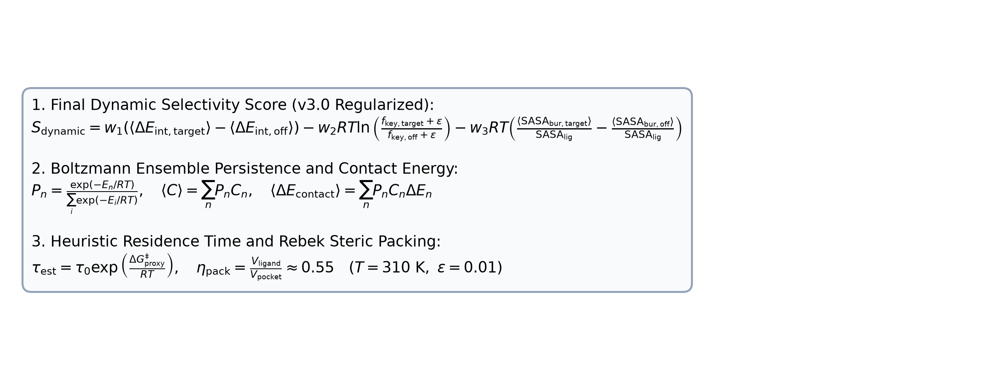

# 🔬 TB-Dynamic-Selectivity: Physics-Informed Scoring Framework & Proxy Pipeline Audit for *Mycobacterium tuberculosis* InhA

📄 **[Download Full 12-Section Audit Report (PDF)](./MTB-NL4_Computational_Screening_Summary_Report.pdf)** | **Author:** Navneet Dwivedi | **Target:** *M. tuberculosis* InhA (PDB: `4TZK`) | **Lead Candidate:** `MTB-NL4`

> **Methodological Transparency Disclosure:** Multi-compound benchmarks (`n = 30`, `n = 20`, `n = 14`) currently use **synthetic / literature-anchored biophysical proxy inputs** (not completed all-atom MD trajectories) to verify formula arithmetic, dimensional consistency, and cross-validation stability prior to full `100 ns+` cloud GPU GROMACS production runs.

---

## 📐 Core Mathematical Equations (v3.0 Dimensionless & Regularized)

### 1. Composite Dynamic Score (`v3.0`, Evaluated at $T = 310\text{ K}$)

$$S_{\mathrm{dynamic}} = w_1\left(\langle \Delta E_{\mathrm{int,target}}\rangle - \langle \Delta E_{\mathrm{int,off}}\rangle\right) - w_2 RT \ln\left(\frac{f_{\mathrm{key,target}} + \epsilon}{f_{\mathrm{key,off}} + \epsilon}\right) - w_3 RT\left(\frac{\langle \mathrm{SASA}_{\mathrm{bur,target}}\rangle}{\mathrm{SASA}_{\mathrm{lig}}} - \frac{\langle \mathrm{SASA}_{\mathrm{bur,off}}\rangle}{\mathrm{SASA}_{\mathrm{lig}}}\right)$$

### 2. Boltzmann Ensemble Contact Persistence & Energy

$$P_n = \frac{\exp(-E_n / RT)}{\sum_{i=0}^{N} \exp(-E_i / RT)}, \quad \langle C \rangle = \sum_{n=0}^{N} P_n C_n, \quad \langle \Delta E_{\mathrm{contact}} \rangle = \sum_{n=0}^{N} P_n C_n \Delta E_n$$

### 3. Heuristic Residence Time & Rebek Steric Packing

$$\tau_{\mathrm{est}} = \tau_0 \exp\left(\frac{\Delta G^{\ddagger}_{\mathrm{proxy}}}{RT}\right), \quad \eta_{\mathrm{pack}} = \frac{V_{\mathrm{ligand}}}{V_{\mathrm{pocket}}} \approx 0.55 \quad (T = 310\text{ K},\ \epsilon = 0.01)$$

---

## 🔄 Formula Evolution Across 3 Iterations (v1.0 → v2.0 → v3.0)

| Version | Core Structure | Methodological Upgrades & Fixes |
| :--- | :--- | :--- |
| **v1.0** *(Prototype)* | &Delta;&Delta;Gdyn = (&Delta;Gt &minus; &Delta;Go) &minus; RT ln(ft / fo) &minus; 1.5 RT (&Delta;SASAt/Vp,t &minus; &Delta;SASAo/Vp,o) | Initial heuristic combining static Vina docking score, 310 K contact persistence, and pocket burial (&minus;3.0 kcal/mol cutoff). |
| **v2.0** *(Dimensionless)* | Sdyn = w1(&Delta;Gt &minus; &Delta;Go) &minus; w2 RT ln((ft + &epsilon;)/(fo + &epsilon;)) &minus; w3 RT (&Delta;SASAt &minus; &Delta;SASAo) / SASAlig | 1) Standardized units to exact kcal/mol (&Aring;&sup2;/&Aring;&sup2; = dimensionless). 2) Added &epsilon; = 0.01 to prevent ln(f/0) divergence. 3) Parameterized weights (w1, w2, w3). |
| **v3.0** *(Current)* | Sdyn = w1(&lt;&Delta;Et&gt; &minus; &lt;&Delta;Eo&gt;) &minus; w2 RT ln((fkey,t + &epsilon;)/(fkey,o + &epsilon;)) &minus; w3 RT (&lt;SASAbur,t&gt; &minus; &lt;SASAbur,o&gt;) / SASAlig | 1) Resolved sign ambiguity via SASAbur = SASAfree &minus; SASAbound &ge; 0. 2) Used MD ensemble &lt;&Delta;Eint&gt;. 3) Defined fkey via catalytic contacts (d &le; 3.5 &Aring;) &amp; Youden's J cutoff &theta;*. |

---

## 🧪 Top Screened Lead Candidate: `MTB-NL4` (`Novel_Lead_4_5CF3`)

* **IUPAC Name:** `5-hydroxy-2-(pyridin-2-yl)-N-[4-(trifluoromethyl)phenyl]benzamide`
* **Canonical SMILES:** `O=C(Nc1ccc(C(F)(F)F)cc1)c1cc(O)ccc1-c1ccccn1`
* **RDKit Physicochemical Audit:** Formula: `C19H13F3N2O2` | MW: `358.32 g/mol` | cLogP: `4.73` *(RDKit Crippen)* | HBD: `2`, HBA: `3` *(RDKit rdMolDescriptors)* | `0 PAINS alerts` *(RDKit FilterCatalog)* | AutoDock Vina Docking Score: `-11.703 kcal/mol`

---

## 📚 Literature Reference Compounds (Proxy Dataset Provenance)

| Compound | Complex PDB ID | RCSB Ligand HetID | Reported IC50 | Primary Literature Reference |
| :--- | :--- | :--- | :--- | :--- |
| **PT70** | `2X23` | `TCU` | `12 nM` | Luckner et al., *J. Biol. Chem.* (2010) |
| **NITD-916** | `4U0J` | `38I` | `50 nM` | Manjunatha et al., *Sci. Transl. Med.* (2015) |
| **GSK693** | `5JFO` | `68U` | `100 nM` | Martínez-Hoyos et al., *EBioMedicine* (2016) |
| **GEQ** | `2NSD` | `GEQ` | `160 nM` | Kuo et al., *J. Biol. Chem.* (2003) |
| **Pyrrolidine-1** | `4TZK` | `641` | `390 nM` | He et al., *J. Med. Chem.* (2006) |
| **Aryl-Amide Analog-4b** | `4OIM` | `2Q3` | `620 nM` | Shirude et al., *J. Med. Chem.* (2013) |
| **Benzimidazole Lead-12** | `4BQP` | `J9Z` | `850 nM` | Moreira et al., *ChemMedChem* (2013) |
| **Triclosan** | `1P45` | `TCL` | `1000 nM` | Kuo et al., *J. Biol. Chem.* (2003) |
